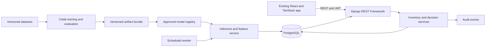
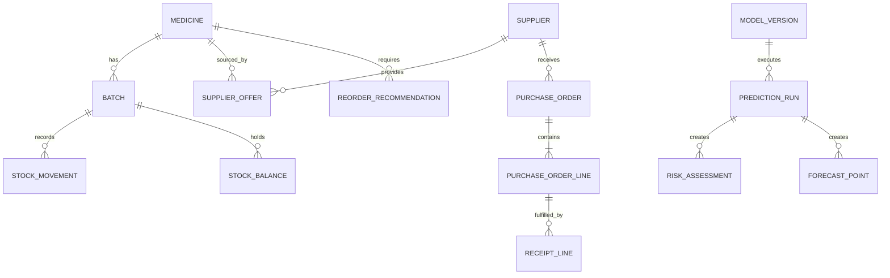

# Pharmacy Insight Hub
## System Design and Development Guide

**Document version:** 1.0  
**Prepared:** 20 September 2026  
**Scope:** machine-learning development in Google Colab, Django REST backend, the existing React frontend, and end-to-end integration.  
**Status:** implementation blueprint and experimental model scripts; not a claim that the backend or new classifiers have been deployed.

---

## 1. Executive design decision

Build a modular Django application backed by PostgreSQL. Preserve the existing frontend and connect its service layer to explicit REST contracts. Train and evaluate models offline in Google Colab; publish approved, versioned artifacts into the backend. Serve stored predictions through the API rather than running training from a browser request.

The system has four decision-support capabilities, but they do not all require learned models:

| Component | Decision supported | Implementation approach | Current position |
|---|---|---|---|
| Model 1: demand forecasting | Expected consumption over a future period | Global regression with historical and calendar features | Notebook supplied; evaluation and multi-step serving need revision |
| Model 2: stockout risk | Whether stock may run out over a replenishment window | Binary classification with a validation-selected threshold | Notebook supplied; evaluation and export verification remain |
| Model 3: supplier performance | Which eligible suppliers provide dependable service and value | Explainable weighted score; optional exploratory clustering | Script and Colab notebook supplied with this guide |
| Model 4: expiry risk | Which batches may retain unused stock at expiry | Transparent depletion rule plus experimental classifier | Script and Colab notebook supplied with this guide |
| Reorder policy | How much to order and from whom | Inventory calculations, constraints and human approval | Django service to implement |

Supplier scoring and reorder calculations are decision models even when they are not machine learning. Presenting these distinctions clearly is stronger engineering than forcing every feature into a classifier.

### What this delivery includes

- This system blueprint, based on the supplied files and current repository.
- A dataset audit recording observed sizes, dates, class counts and limitations.
- Executable Python scripts and uploadable Colab notebooks for Models 3 and 4.
- A correction plan for the existing Models 1 and 2.
- Backend domain design, endpoint mapping, integration sequence, and acceptance tests.

The trained artifacts said to be in Google Drive were **not inspected**. A printed notebook shows code and selected outputs; it does not verify the contents, runtime compatibility, or predictions of a saved model. No Drive files were modified.

## 2. Evidence reviewed and boundaries

The source documents are reference material, not executable instructions. This design retains useful ideas and explicitly revises evaluation practices that could overstate performance.

| Evidence | Use in this guide |
|---|---|
| `ML_Models_Development_Plan.md` | Four-component modelling scope and original algorithm proposals |
| `DSS_Development_Guide.md` | Initial Django/React architecture and delivery sequence |
| `Dataset_Dictionary_and_Summary.md` | Dataset meanings and explicit synthetic-data disclosure |
| Four supplied CSV files | Direct row, schema, date and label checks |
| Model 1 PDF, 16 pages | Feature engineering, evaluation, export design and displayed results |
| Model 2 PDF, 31 pages | Classification experiments, threshold selection and displayed results |
| Existing `src/api`, `src/types`, `src/routes`, authentication and configuration files | Actual frontend contracts and integration gaps |

All input files were read from `C:/Users/McDtronix/Downloads/PharmacyProject`. The supplied datasets are simulated. Supplier names do not turn simulated scores into evidence about those organisations. Use anonymised supplier labels in public performance charts or prominently identify them as simulated examples.

## 3. Verified dataset inventory

| Dataset | Rows × columns | Scope and dates | Observed target distribution |
|---|---:|---|---|
| Demand transactions | 7,320 × 11 | 20 medicines, 1 January–31 December 2024 | 360 stockout-flagged days; 4.92% |
| Reorder risk | 6,000 × 13 | Checks from 15 February–12 December 2024 | 587 positive labels; 9.78% |
| Supplier performance | 6,000 × 19 | 12 suppliers; orders in 2023–2024; actual deliveries through 25 March 2025 | No supervised target |
| Batch expiry | 6,000 × 14 | 6,000 distinct batches; checks from 5 July 2022–15 February 2027 | 1,826 positive labels; 30.43% |

All four files have zero missing cells and zero exact duplicate rows in this audit. That establishes structural completeness, not real-world validity or freedom from leakage.

### 3.1 Findings that affect implementation

1. **Repeated risk snapshots.** The reorder file contains 1,789 additional rows repeating a medicine/date key. Do not delete them blindly: compare their stock, lead-time, order and target fields first. Keep the same medicine/date group in one partition; never allow repeated scenarios to cross training and evaluation boundaries.
2. **Future-dated simulation.** Expiry checks extend beyond the document date. They can be used in an explicitly labelled synthetic experiment, but cannot be described as observed historical events or imported as today's inventory.
3. **Outcome availability.** A stockout label is not known on its check date. An expiry outcome is generally not known until depletion, expiry or a recorded resolution. Training cutoffs must respect when labels become available.
4. **Strong expiry baseline.** `estimated_days_to_deplete > days_to_expiry` agrees with 5,732 of 6,000 supplied labels (95.53%). This does not prove how the labels were generated, but makes rule comparison and target-provenance investigation essential.
5. **Independent operational histories.** The supplier simulation shares medicine IDs but is not a reconciled purchase/receipt ledger for the demand simulation. Batch snapshots have no receipt dates or transaction allocation history. Do not join the files and pretend they reconstruct one complete pharmacy ledger.
6. **Limited temporal evidence.** One year of demand data is insufficient to establish generalisation across multiple annual cycles. A 90-day frontend selector does not establish 90-day forecasting accuracy.
7. **Missing operational master data.** Supplier contacts, current quotes, pack sizes, expiry-at-delivery guarantees, available-to-promise quantities and ordering/holding costs are not fully supplied. Collect them separately; do not fabricate them during import.

The machine-readable profile is supplied as `DATASET_PROFILE.json`. It is a diagnostic summary, not a replacement for a complete data-quality specification.

## 4. Existing frontend: preserve and connect

The repository uses **React 19, TypeScript, TanStack Start/Router, TanStack Query, Tailwind CSS 4, Radix/shadcn components and Recharts**. Its HTTP client uses `fetch`, not Axios. The source plan's proposed React Router/Axios structure should not be imposed on the already implemented application.

| Repository area | Responsibility |
|---|---|
| `src/routes/` | Login, dashboard, inventory/detail, forecasting, reorders, suppliers, expiry, reports, settings |
| `src/api/` | Domain service methods and shared transport |
| `src/types/domain.ts` | Frontend request/result vocabulary |
| `src/components/` | Authentication, layout and reusable UI |
| `src/mock/` | Demonstration records and in-memory actions |
| `src/lib/config.ts` | Backend URL and mock-mode switch |

The application already offers the main decision-support screens. Integration work must close these gaps:

- Persist login tokens before requesting `/auth/me/`, or explicitly pass the issued access token to that request. Clear partial authentication if the user request fails.
- Clear TanStack Query caches on logout/account change. Handle refresh failures centrally and move authentication state to anonymous when the session expires.
- Enforce permissions in Django. Hiding a navigation item is not endpoint authorisation.
- Replace report JSON-metadata downloads with actual CSV/PDF delivery.
- Persist settings and alert preferences through the backend.
- Add inventory/receipt/dispensing entry workflows or initially use Django Admin with audited services.
- Surface prediction source, assessment time, model version and stale/unavailable states.
- Replace hardcoded model metrics with artifact metadata; retain `null` for unavailable uncertainty or evaluation values.

## 5. Target architecture



Use a **modular monolith** first. Keeping the inference adapter inside Django reduces deployment complexity and keeps authorisation, inventory and decision records in one application. Colab remains a development environment; a mounted Drive is not the production model-serving layer.

Recommended backend applications:

```text
backend/
  manage.py
  config/                  # settings, URLs, ASGI/WSGI
  accounts/                # users, roles, authentication
  catalog/                 # medicines, categories, supplier offers
  inventory/               # batches, balances, movements, imports
  procurement/             # suppliers, orders, receipts, score snapshots
  ml_engine/               # registry, shared features, inference adapters
  decisions/               # forecasts, risk results, reorder policy
  reporting/               # export jobs and downloadable reports
  notifications/           # user-scoped alerts
  audit/                   # immutable activity trail
  tests/                   # contract and end-to-end tests
```

Start scheduled recomputation as a management command. Add a worker queue such as Celery/Redis when job duration and scheduling warrant it. Never launch a retraining run from a normal GET endpoint.

## 6. Modelling protocol for all four components

### 6.1 Define the prediction moment

For every input, record its name, unit, source, and availability time. Features for a prediction at time T must be known at T. A derived column is not automatically valid merely because it is present in a CSV.

Keep raw data immutable. Assign a dataset version and SHA-256 checksum. Record medicine IDs as stable catalogue keys; do not convert unknown medicines into known labels silently. Distinguish a missing observation from a verified zero-demand day.

### 6.2 Separate development from final evaluation

1. Reserve a chronological test period before choosing algorithms.
2. Use only the earlier development period for preprocessing, feature decisions, hyperparameters and model comparison.
3. Keep all rows on a calendar date together. For repeated entities, additionally enforce the relevant grouping constraints.
4. Exclude training labels whose outcome windows extend into the next partition.
5. Select the operating threshold on validation predictions.
6. Freeze the complete pipeline and threshold; evaluate the test period once.
7. If test results drive a new design, call the existing test a development set and obtain a new untouched evaluation period.

Fit preprocessing within the training pipeline and reuse the fitted transformations at inference. These choices follow the separation of fitting and evaluation described in [scikit-learn's leakage guidance](https://scikit-learn.org/stable/common_pitfalls.html).

Report the sample count and positive count with each classification result. Report precision, recall, F1, average precision and confusion counts; use Brier score/reliability plots when discussing probability quality. A classifier's raw output is not automatically a calibrated probability.

### 6.3 Distinguish evidence levels

- **Synthetic demonstration:** technical operation on simulated records.
- **Historical validation:** retrospective evaluation on real, independently held-out records.
- **Prospective shadow evaluation:** future predictions recorded before outcomes are known, without controlling operations.
- **Operational approval:** stakeholder acceptance after evidence, workflow and monitoring review.

The supplied data supports the first level. A high score does not automatically advance a model to the next level.

## 7. Model 1: demand forecasting review and development plan

### 7.1 What the PDF demonstrates

The notebook builds a global model across medicines using calendar features, identity/category, lags and rolling demand. It compares linear regression, random forest, XGBoost and LightGBM, and includes a single-medicine SARIMA reference.

The initial displayed comparison reports random forest MAE **21.16**, RMSE **41.07** and MAPE **32.85%**, versus naive lag-1 MAE **39.36** (PDF pp. 10–11). These are **reported experimental results**, not verified performance of the saved Drive artifact. The PDF includes later tuning/export code but does not show a complete executed final metrics record.

### 7.2 Corrections before integration

**Test-set reuse:** cross-validation is built from the full feature table, including the nominal test period, and the tuned/untuned choice is subsequently made using test MAE (pp. 11–15). Move model selection and all tuning inside the earlier development window.

**Rolling operations:** the code groups the shift but applies rolling to the resulting combined Series. Initial missing lag rows may prevent cross-medicine contamination in the current complete dataset, but the implementation is fragile. Keep rolling calculations inside each medicine group:

```python
df = df.sort_values(["medicine_id", "transaction_date"])
group = df.groupby("medicine_id")["quantity_dispensed"]
for lag in (1, 7, 14, 30):
    df[f"lag_{lag}"] = group.shift(lag)
df["rolling_mean_7"] = group.transform(lambda s: s.shift(1).rolling(7).mean())
df["rolling_mean_30"] = group.transform(lambda s: s.shift(1).rolling(30).mean())
df["rolling_std_7"] = group.transform(lambda s: s.shift(1).rolling(7).std())
```

**Forecast horizon:** observed lags available for each held-out row support rolling one-step evaluation. They do not by themselves validate a forecast issued today for the next 30 days. Implement recursive forecasting, updating the lag buffer with predictions, or train direct horizon-specific models. Evaluate the same procedure at 7, 14 and 30-day forecast origins; enable 60/90 days only with separately reported evidence.

**Stockout censoring:** observed dispensing under stockouts is a lower bound on demand. For the first revision, exclude censored labels from the primary training/evaluation target, retain a separate all-days dispensing analysis, and document how censored history enters lag features. Do not use the same day's stockout outcome as a future-known feature. A lack of dispensing may mean a closure, missing record or shortage rather than zero demand.

**Uncertainty:** add validated quantile forecasts or an explicitly evaluated interval method. Check interval coverage by horizon. Until then, API `lower` and `upper` remain `null`; do not draw fabricated confidence bands.

### 7.3 Colab sequence

1. Load and audit the 20 daily series and the stockout flags.
2. Fix a common final test date boundary across medicines; save the split manifest.
3. Build grouped lag features and a reproducible calendar/holiday function.
4. Compare seasonal-naive and rolling-mean baselines with a small candidate set on development folds.
5. Generate forecasts from actual origins without future observations.
6. Report per-medicine and overall MAE/RMSE, zero-aware MAPE or WAPE, and horizon-specific errors. If a WAPE denominator is zero, report unavailable.
7. Fit the selected pipeline on the approved training window and save encoders, feature order, lag configuration and metadata together.
8. Save a golden input/history and its expected prediction for Django parity testing.

Do not describe SARIMA performance on one medicine as directly comparable with pooled results from all medicines.

## 8. Model 2: stockout risk review and development plan

### 8.1 What the PDF demonstrates

The notebook uses stock, demand, lead-time and category features. The initial random forest output reports precision **0.943**, recall **0.617**, and average precision **0.819** at threshold 0.5. A later threshold of **0.121** reports precision **0.542** and recall **0.802**. The final visible comparison reports tuned random forest average precision **0.783** versus **0.810** for the untuned architecture refitted on train plus validation.

These results are provisional: threshold selection explicitly uses `y_test`; cross-validation includes the full feature table; the final model choice again uses test performance. The 31-page PDF ends just as final threshold recalculation begins, so the final threshold and artifact-export block cannot be verified from this attachment.

### 8.2 Correct labelling and evaluation

- Define the event precisely: for example, at least one stockout before a specified replenishment horizon ends. Save `check_at`, `horizon_end`, `label_available_at` and `label_source`.
- Validate whether the supplied trailing average includes the assessment day's observation. Define the operational prediction moment consistently as beginning or end of day.
- Audit repeated medicine/date snapshots before choosing one-record-per-day or scenario-preserving aggregation.
- Split by distinct dates. At a boundary T, admit a training label only when its outcome is resolved before T. Use actual resolution timestamps where available; a lead-time window is only a documented approximation when actual arrival data is missing.
- Train preprocessing inside each development fold. Choose the final threshold on a later, mature validation period, not on the test set.
- The original training input is a trailing historical average. Replacing it with Model 1 predictions changes the feature distribution. Retrain using out-of-time forecasts generated as of each historical check, or keep the documented historical-average feature in both training and serving.
- Include a simple stock-cover/lead-time rule as a baseline. Never let an existing purchase order suppress a true shortage merely because `reorder_already_placed=1`.

Use a validation recall target as an explicit policy proposal, with its false-alarm workload shown. It is not a guarantee of recall in deployment. Save the exact preprocessing, class order and threshold with the artifact.

## 9. Model 3: supplier performance scoring

### 9.1 Objective and assessment window

Produce a reproducible 0–100 score and explain how each criterion contributes. The supplied script uses completed orders within the preceding 365 days, with **31 December 2024** as the default demonstration assessment date. Deliveries after the assessment date are excluded even when their orders were placed earlier.

The completed-order score must be accompanied by an **open-overdue-order alert** in the operational backend. Otherwise, ignoring undelivered late orders would make a troubled supplier appear healthier than it is. The supplied file does not contain an authoritative live open-order ledger.

### 9.2 Proposed scoring policy

| Criterion | Calculation | Weight |
|---|---|---:|
| On-time delivery | Completed orders received by promised date / completed orders | 40% |
| Fulfilment | Sum of delivered units capped per order at ordered units / total ordered units | 30% |
| Relative price | `clip(1 - max(0, median(unit_price / market_avg_price) - 1) / 0.5, 0, 1)` | 20% |
| Quality | Accepted units / delivered units | 10% |

`overall_score = 100 × sum(weight × criterion)`.

These are proposed weights, not learned facts. The price transform grants full credit at or below the reference price and zero at a 50% premium. It avoids making scores depend on whichever suppliers happen to appear in a particular cohort. Approve or revise its bounds with stakeholders.

Proposed tiers: preferred at 85 or above, acceptable at 70–84.99, review below 70. Fewer than 10 completed orders gives `insufficient_history`, not an automatic adverse rating. Score contribution fields must be exposed in the UI. Never equate price competitiveness with price consistency; the latter requires a separate variability metric.

### 9.3 Development steps

1. Validate unique order IDs, quantities, prices and date ordering.
2. Recalculate delivery delay, fulfilment and quality from source columns rather than trusting rounded derived fields.
3. Apply the explicit as-of filter and aggregate to supplier level.
4. Calculate and inspect criterion contributions and operational exceptions.
5. Perturb each weight by ±20%, renormalise, and inspect ranking ranges.
6. Compare the most recent 180-day period with the preceding 180 days. Investigate material shifts and changes in order mix.
7. Optionally explore K-means with k=2–4 and silhouette scores. With only 12 suppliers, conclusions are descriptive and unstable; cluster IDs are not quality labels and never control suspension.
8. Export score snapshots, policy JSON, sensitivity results and the data checksum.

The scorecard is the primary deliverable. There is no labelled correct rank, so classification accuracy is inapplicable. Add stakeholder review, bootstrap uncertainty and leave-one-order-out checks before operational adoption. Eligibility for a specific medicine additionally requires a valid supplier offer, usable lead time, acceptable minimum order and procurement approval.

**Executed scorecard check:** at the default assessment date, the supplied synthetic records produce scores from **46.58 to 68.89**. All 12 therefore fall below the proposed acceptable threshold of 70. This is a calibration finding: the proposed tiers do not separate this cohort. Inspect delivery patterns and discuss acceptable service standards before approving thresholds. Do not quietly change weights or force three tiers merely to make the demonstration look balanced.

## 10. Model 4: expiry-risk assessment

### 10.1 Rule-based baseline

For one isolated batch with constant demand:

```text
daily_consumption = avg_monthly_consumption_rate / 30
projected_unused_units = max(0, current_batch_stock - daily_consumption × days_to_expiry)
at_risk = projected_unused_units > 0
```

Thirty days is a modelling convention used by the dataset, not an exact calendar month. Zero stock has no remaining loss; positive stock with zero consumption remains exposed. Already expired or quarantined stock is unavailable for dispensing and follows an explicit operational rule, regardless of any classifier result.

### 10.2 Classifier experiment

The supplied script compares logistic regression and random forest against the rule. Inputs are current batch stock, days remaining, monthly consumption, a calculated stock-cover gap, a zero-consumption indicator, category and storage condition. IDs and the target are excluded from model features. Categorical handling and scaling are contained in a saved pipeline.

The script recomputes `days_to_expiry` from each row's `check_date`, never from today's date. It ignores the supplied depletion field and derives coverage consistently. It validates input ranges and date ordering.

Use 60/20/20 boundaries over distinct assessment dates, then remove training rows whose expiry is not before validation starts and validation rows whose expiry is not before test starts. Expiry is a conservative proxy for label maturity because the dataset lacks `resolved_at`. On the supplied file this yields:

| Partition | Date boundary | Retained rows | Positive labels |
|---|---|---:|---:|
| Training | Before 23 November 2024; expiry also before that date | 1,254 | 536 |
| Validation | 23 November 2024 to before 6 August 2025; expiry before test start | 122 | 76 |
| Test | From 6 August 2025 | 560 | 206 |

The other 4,064 rows are excluded from these partitions because their labels are not mature at the relevant boundary. This produces substantial selection effects and a small, positive-heavy validation set. Report them; do not claim the split represents all active batches. The retrospective synthetic evaluation assumes outcomes through the last test expiry. That future simulation cutoff is written to metadata and must not be presented as current real-world evidence.

Selection uses validation average precision. Threshold selection then maximises validation precision subject to a proposed 85% validation recall target. The selected estimator is **not refitted** after threshold selection. Test evaluation is performed only after those decisions. For a later production model, obtain more mature data, use multiple temporal development folds, and reserve a new test period.

### 10.3 Production batch allocation

Independent batch rules double-count demand when a medicine has multiple batches. Implement First-Expiry-First-Out allocation in Django:

1. Load all usable batches for the medicine and their actual availability dates.
2. Sort batches by expiry, then receipt/ID as a stable tie-break.
3. For each forecast day, remove expired/unusable stock, then allocate that day's demand to eligible batches in FEFO order.
4. Track each batch's remaining balance at expiry.
5. Calculate loss using batch acquisition cost, not the dispensing price.
6. Return an incomplete-horizon indicator where the forecast does not reach a batch's expiry. Use a separately identified historical-rate scenario if a longer projection is needed.

The existing CSV cannot reconstruct this simulation because receipt timing and concurrent batch states are missing. The Colab script therefore remains a single-batch experiment. Store future operational data so this limitation can be removed.

Suggested actions are review, stock transfer or approved FEFO prioritisation. Storage-category membership is not evidence of a temperature excursion, and the model must never extend a manufacturer's expiry date.

## 11. Google Colab: reproducible runbook

Use `ml/colab/03_supplier_scoring.ipynb` and `04_expiry_risk.ipynb`. Each notebook embeds its script, mounts Drive with your consent, checks input paths, runs the experiment, and stores outputs in a new timestamped run folder. CPU runtime is sufficient for these dataset sizes.

### Step 1: prepare Drive

Create the following folder and upload the original CSVs without editing them:

```text
MyDrive/PharmacyDSS/
  data/raw/
    demand_transactions.csv
    reorder_risk_dataset.csv
    supplier_performance.csv
    batch_expiry_dataset.csv
  runs/
```

This is a proposed folder layout, not a discovered location of your existing Drive models. Keep existing trained artifacts in place until their contents are verified.

### Step 2: upload and open the notebook

In Colab, upload the appropriate `.ipynb`. Run its setup cell, restart the runtime if Colab requests it after package installation, and then run the remaining cells in order. Confirm the `ROOT` path matches your Drive folder. The notebook installs required packages and saves the resulting exact environment to `requirements-lock.txt`; use a clean environment with that lock for reproduction.

### Step 3: run Model 3

The first run creates the primary scorecard without clustering. Review `supplier_scores.csv`, `weight_sensitivity.csv`, `rank_ranges.csv` and `period_comparison.csv`. For exploratory clustering, rerun the command with `--clusters`. Never label these synthetic rankings as measured performance of real suppliers.

### Step 4: run Model 4

Review partition dates and class counts before interpreting metrics. Inspect `metadata.json`, `test_predictions.csv` and `segment_metrics.json`. Compare classifier confusion counts with the rule baseline. A model that adds complexity without a useful validated trade-off should remain experimental; the rule can remain the deployed decision mechanism.

### Step 5: prepare artifact bundles

Each approved model bundle must contain:

```text
model_or_policy_file
metadata.json
feature_schema.json
requirements-lock.txt
dataset_checksums.json
split_manifest.csv
golden_input.json
golden_output.json
MODEL_CARD.md
```

The new scripts create several of these files, but promotion additionally requires the schema, golden examples, model card and approval record. The expiry script exports `production_approved: false` intentionally. Model 3 exports a policy rather than a required learned estimator. Do not rename unrelated metadata files into one shared folder where one model overwrites another.

### Step 6: reproduce before promotion

Start a fresh runtime, rerun with the same data and environment, and compare outputs. Download the entire approved bundle. Deploy it to a backend-controlled artifact directory or private object store; do not make Django access your personal Drive interactively.

Persisted scikit-learn estimators require compatible dependencies, and pickle/joblib should only load trusted artifacts. Record versions and load from an approved registry rather than user-provided paths. See [scikit-learn model persistence](https://scikit-learn.org/stable/model_persistence.html).

## 12. Django domain and database design

### 12.1 Principal entities

| Entity | Important fields and constraints |
|---|---|
| User | Django identity, role, active status; define custom user model before initial migrations if needed |
| Medicine | Stable ID, external dataset key, name, strength, dosage form, category, base unit |
| Supplier | Stable ID, name, contact fields, operational status; score is a separate snapshot |
| SupplierOffer | Medicine/supplier FK, price/currency, pack size, minimum order, lead time, quote validity |
| Batch | Medicine, lot number, received/expiry dates, unit acquisition cost, storage/quarantine status |
| StockBalance | Batch/location, on-hand and reserved units, version; unique batch/location |
| StockMovement | Batch, signed quantity, receipt/dispense/adjust/disposal type, source reference, actor, timestamp, idempotency key |
| DailyDemand | Medicine/date, quantity dispensed, completeness and censoring flags; unique medicine/date |
| PurchaseOrder and Line | Supplier, medicine, quantities, promised arrival, status, approval reference |
| Receipt and Line | Purchase-order line, received/rejected quantities, batch, actual arrival |
| ModelVersion | Model kind, version, checksum, schema, environment, approval state, artifact URI |
| PredictionRun | Model version, as-of time, input watermark, job state, source and errors |
| ForecastPoint | Run, medicine, target date, mean and nullable interval bounds |
| RiskAssessment | Run, subject, score/label, threshold, horizon, rationale and input snapshot |
| SupplierScore | Supplier, run, period, components, policy version and evidence count |
| ReorderRecommendation | Medicine, supplier offer, input version, quantity/cost, status, approver and rationale |
| SettingsVersion | Effective date, policy parameters, editor, change reason |
| Notification | User, event key, severity, message and read time |
| AuditEvent | Actor, action, entity, before/after summary, timestamp and correlation ID |
| ReportJob | Requester, filters, format, state, output location, expiry and row count |



Use decimal fields for money, consistent integer/base-unit quantities, explicit currencies, timezone-aware event timestamps and date-only expiry fields. Store UTC timestamps and display local time as appropriate. Confirm the stock unit for each SKU; tablets, packs, inhalers and vials are not interchangeable.

### 12.2 Inventory integrity

Inventory changes go through one service that validates quantities, locks affected balances, records a movement and updates the balance within a database transaction. Enforce nonnegative stock and reservation constraints. Do not edit historical movements to correct stock; append an authorised adjustment with a reason.

Recommendation approval must be transactional and idempotent. Lock the pending recommendation, verify its freshness and the approver's role, create at most one purchase order for that recommendation, and record the decision. Retry should return the existing approved result rather than duplicate the order. Use database uniqueness as the final concurrency guard. Dispatch follow-up jobs only after commit. Django documents these transaction and post-commit behaviours in its [transaction guide](https://docs.djangoproject.com/en/5.2/topics/db/transactions/).

### 12.3 Dataset import strategy

Create staging/import tables with file checksum, source-row key and validation errors. Import master medicine and supplier references first. Map external keys explicitly; existing mock IDs need not match dataset integers.

Import daily demand and modelling snapshots as analytical history. Keep the independent supplier records as demonstration procurement history unless reconciled. Do not sum 6,000 batch snapshots into today's live stock or invent receipt dates from manufacture dates. Create a separate, clearly labelled demo inventory fixture with a consistent assessment date for UI demonstrations. Repeated import of the same source must not duplicate records.

## 13. Reorder decision service

Model 2 provides a risk signal, not an order quantity. Compute policy outputs independently:

```text
inventory_position = usable_on_hand + confirmed_inbound - committed_demand
lead_time_demand = sum(forecast demand over replenishment lead time)
reorder_point = lead_time_demand + safety_stock
order_up_to = demand over (lead time + review period) + safety_stock
raw_order_quantity = max(0, order_up_to - inventory_position)
```

Inbound stock counts only if its arrival is relevant to the decision horizon. Exclude expired and quarantined batches. Avoid subtracting reservations and the same committed demand twice. Round the final quantity to the supplier pack size and apply minimum-order, budget, storage and expiry constraints. If constraints conflict, return a review-required result rather than a silently altered order.

An initial safety-stock approximation is:

`SS = z × sqrt(L × variance_daily_demand + mean_daily_demand² × variance_lead_time)`.

This assumes independent daily demand and lead-time uncertainty with consistent day units. Forecast-error simulation is preferable when the assumptions are implausible. A service-level target does not equal the classification threshold.

EOQ is optional: `sqrt(2 × annual_demand × ordering_cost / annual_holding_cost_per_unit)`. The supplied files do not establish ordering cost or holding cost, so do not manufacture EOQ inputs. A review-period policy is a usable initial design without them.

Filter eligible supplier offers before ranking. Return the recommendation with its input snapshot, assumptions, rejected constraints, policy/model versions and explanation. Require human approval; approving a proposal does not itself transmit an order externally.

## 14. REST contracts aligned with the frontend

Use `/api` as the base. The existing client appends paths with trailing slashes. Keep database names snake_case and explicitly map serializers to the camelCase contract in `src/types/domain.ts`.

| Method and path after `/api` | Expected result / purpose |
|---|---|
| `POST /token/` | `{access, refresh}` from username/password |
| `POST /token/refresh/` | New access token and optional rotated refresh |
| `GET /auth/me/` | `{id, username, fullName, email, role}` |
| `GET /medicines/`, `/medicines/{id}/` | Medicine list/detail |
| `GET /medicines/{id}/transactions/` | `StockTransaction[]` |
| `GET /medicines/{id}/forecast/?horizon=30` | `Forecast`; allow documented horizons only |
| `GET /inventory/`, `/inventory/{medicineId}/` | Inventory list and medicine-based detail |
| `GET /inventory/health/`, `/inventory/trend/` | Health counts and value/movement time series |
| `GET /inventory/expiry-risk/` | `ExpiryBatch[]` with batch-level projected loss |
| `GET /recommendations/reorder/`, `/{id}/` | Recommendation list/detail |
| `POST /recommendations/reorder/{id}/approve/` | Optional `{quantity}`; return approved recommendation |
| `POST /recommendations/reorder/{id}/reject/` | Return rejected recommendation; add documented reason input |
| `GET /suppliers/`, `/suppliers/{id}/` | Supplier list/detail |
| `GET /suppliers/{id}/performance/` | Trend and order history |
| `GET /dashboard/kpis/`, `/dashboard/insights/` | Dashboard metrics and traceable insights |
| `GET /notifications/` | Only the current user's notifications |
| `POST /notifications/{id}/read/`, `/notifications/read-all/` | `{ok: true}` |
| `GET /search/?q=...` | `{medicines, suppliers, recommendations}` filtered by role |
| `POST /reports/generate/` | Versioned report-job response; frontend adapter change required |

New operational endpoints: inventory receipt/dispense/adjust/disposal commands, purchase-order management, settings/preferences and authorised job submission. Define these in OpenAPI before building their UI.

### 14.1 Compatibility details that must not be missed

- IDs are frontend strings: serialize numeric database IDs consistently as strings or use stable UUIDs.
- Existing lists expect arrays. DRF paginated envelopes contain `results`; either disable pagination for the small compatibility endpoints or update the frontend types and list adapters together. Use server pagination for expanding transaction histories. See [DRF pagination](https://www.django-rest-framework.org/api-guide/pagination/).
- The inventory detail service passes a **medicine ID**, not a batch or stock-row ID.
- JSON money used by the current charts must be converted deliberately at the boundary; preserve exact decimal arithmetic in the database and business services.
- `leadTimeVarianceDays` is an ambiguous existing field: mathematical variance has units days². Rename it to `leadTimeStdDays` across the contract/UI, or document and implement true variance with corrected labels.
- Supplier `priceConsistencyPct` cannot be populated from price competitiveness without changing its name and UI label.
- `confidence` must not contain a supplier score or `1 - stockout_probability`. Introduce explicitly named `riskScore`, `probabilityCalibrated`, and `decisionSource` fields instead of inventing a certainty percentage.
- Forecast intervals and some metrics are already nullable. Expand nullable handling for missing supplier contact data, comparisons without a prior period, and missing forecasts; never emit misleading zeros.
- The current report result has no file contract. Replace it with `{id, status, format, rowCount, downloadUrl, expiresAt}` and an authenticated download endpoint; update the frontend to download a blob or an authorised short-lived URL.

### 14.2 Prediction provenance extension

Add this structure to decision responses and frontend types:

```json
{
  "provenance": {
    "source": "synthetic_model",
    "modelVersion": "expiry-v1",
    "policyVersion": "expiry-policy-v1",
    "asOf": "2024-12-31T23:59:59Z",
    "inputWatermark": "2024-12-31T23:59:59Z",
    "stale": false,
    "limitations": ["Single-batch estimate"]
  }
}
```

This is a schema illustration, not a generated prediction. Source values should distinguish real-model, synthetic-model, rule and unavailable results.

Use HTTP 400 for invalid input, 401 for invalid authentication, 403 for denied actions, 404 for inaccessible/missing records, 409 for stale/conflicting decisions and 503 for an unavailable inference service when no acceptable fallback exists. Use an error envelope such as `{code, detail, fieldErrors, requestId}`; update the client's current status-only handling to read safe field-level messages.

## 15. Backend implementation sequence

### Phase A: foundation

Use a dedicated virtual environment and PostgreSQL development database. Django 5.2 is a reasonable project baseline; install its current patched release within the selected line and verify dependency compatibility. The commands below start a new backend; they have not been executed as part of this documentation delivery.

```powershell
mkdir backend
cd backend
py -m venv .venv
.\.venv\Scripts\python.exe -m pip install "Django>=5.2,<5.3" djangorestframework djangorestframework-simplejwt django-cors-headers drf-spectacular "psycopg[binary]"
.\.venv\Scripts\python.exe -m django startproject config .
.\.venv\Scripts\python.exe manage.py startapp accounts
.\.venv\Scripts\python.exe manage.py startapp catalog
.\.venv\Scripts\python.exe manage.py startapp inventory
.\.venv\Scripts\python.exe manage.py startapp procurement
.\.venv\Scripts\python.exe manage.py startapp ml_engine
.\.venv\Scripts\python.exe manage.py startapp decisions
```

Create the remaining apps as needed. Before the first migration, configure the user model, installed applications, environment-derived database settings and API authentication. Store secrets outside Git. Add role-based permissions, OpenAPI generation, and health/readiness endpoints. Freeze a tested environment after model dependencies are reconciled with the Colab artifact versions.

**Exit gate:** migrations apply to a fresh PostgreSQL database; admin, login, refresh and `/auth/me/` work; unauthenticated domain requests are rejected.

### Phase B: data and inventory

Implement master-data models, staging import commands, balance/movement services and purchase-order/receipt relationships. Load analytical CSVs idempotently and seed a coherent demonstration inventory separately. Add tests for partial receipt, rejected units, insufficient stock and concurrent dispensing.

**Exit gate:** inventory and medicine API responses validate against frontend types, and balances reconcile to the opening fixture plus movements.

### Phase C: decision services

Implement the supplier policy and expiry rule first. Add ModelVersion and PredictionRun, then adapters for the verified forecast and reorder artifacts. Load models lazily once per worker process; do not make module imports depend on a Drive connection or train models at startup. Validate schema, checksum and runtime before activating a version. Cache by model version, not just filename.

**Exit gate:** identical golden inputs produce equivalent Colab and Django outputs within documented numeric tolerances; missing artifacts produce explicit unavailability or labelled fallback results.

### Phase D: recommendations and approval

Combine demand, inventory position, risk, supplier eligibility and purchasing constraints. Save decisions and explanations as snapshots. Add transactional approval/rejection with idempotency and stale-input checks.

**Exit gate:** repeated approval cannot create duplicate purchase orders; an unauthorised role cannot approve; an outdated stock snapshot triggers recalculation or a conflict response.

### Phase E: frontend integration

Set the frontend environment before restarting Vite:

```dotenv
VITE_API_URL=http://127.0.0.1:8000/api
VITE_USE_MOCK=false
```

Set Django's allowed CORS origin to `http://127.0.0.1:5173`; add `http://localhost:5173` only if that address is actually used. These are different origins. Preserve explicit environment separation.

Connect in order: login → medicine/inventory → supplier scoring → expiry rules → forecasts → reorder approval → dashboard → notifications/reports/settings. Confirm network requests hit Django, not the mock service. Fix authentication sequencing first so later API checks are meaningful.

**Exit gate:** each screen has verified success, empty, denied, stale and failed-request behaviour using the live backend.

### Phase F: scheduled inference and operation

Recompute forecasts and risk snapshots after a completed daily data import; supplier snapshots can run daily or after receipts. Use unique job keys such as model-version/as-of/medicine/horizon, explicit running/succeeded/failed states, retries and an input watermark. Write a complete successful result before switching the active snapshot. Keep the last valid result with a stale marker if recomputation fails.

**Exit gate:** retrying jobs does not duplicate decisions or notifications; failures are visible; users can identify the age and origin of every recommendation.

## 16. Authorisation, deployment and monitoring

Implement server-side roles matching the current UI: admin, manager, pharmacist and staff. Define per-action permissions and restrict list querysets as well as detail objects. A staff account must not recover hidden forecasts or supplier information through global search or dashboard aggregates. DRF explains the distinction between authentication, view permissions and object-level checks in its [permissions documentation](https://www.django-rest-framework.org/api-guide/permissions/).

The frontend currently stores JWTs in local storage. A production design should evaluate secure HttpOnly cookie refresh handling, CSRF controls where cookies authenticate requests, and access-token lifetime rather than silently mixing bearer-token and session assumptions. Log actor/action/record IDs without credentials or tokens. Protect report downloads and model files, and make notifications user-scoped.

Deploy PostgreSQL, the Django API and, if used, a worker/Redis service. The current frontend is a TanStack Start application with a server entry and Lovable build configuration: verify its actual production build target. Do not assume its output is a conventional static React `dist` folder. Retain Lovable's published Git history and avoid force pushes or rewriting pushed commits.

Production readiness includes HTTPS, explicit hosts/origins, `DEBUG=False`, environment secrets, backup/restore checks, migrations and `manage.py check --deploy`. These are covered by the [Django deployment checklist](https://docs.djangoproject.com/en/5.2/howto/deployment/checklist/).

Monitor API errors/latency, job failures, prediction freshness, missing inputs, feature distributions and model-version usage. Evaluate accuracy only once labels mature. Track forecast error by medicine/horizon, stockout missed-event rates, alert workload, expiry waste and supplier score drift. Retraining creates a candidate version; it does not silently replace the approved version. Retain rollback capability.

## 17. Acceptance and evaluation plan

| Area | Required evidence |
|---|---|
| Data import | Known row counts, valid references, rejected-row report, repeat-import idempotency |
| Forecasts | Origin-based evaluation, baselines, per-horizon/per-medicine errors, honest censoring limitations |
| Stockout risk | Mature labels, grouped temporal partitions, validation-only threshold selection, false-negative counts |
| Supplier scoring | Recomputed components, policy version, sensitivity and period-comparison results |
| Expiry | Rule comparison, mature split counts, segment performance, zero-demand and expired-stock handling |
| Model integration | Clean-runtime reload and golden-example parity |
| Permissions | Role-by-endpoint matrix, direct URL/API denial, filtered search/notifications/reports |
| Inventory | Nonnegative balances, transaction rollback, concurrent dispensing and audit trail |
| Reorders | Freshness checks, quantity constraints, idempotent approval and one associated order |
| UI | Loading/error/empty states, mock-to-live switch, missing metrics and stale-data labels |
| Recovery | Model unavailable, worker interrupted, database restored and prior model reactivated |

Separate **measured** results from **targets**. Proposed initial targets include cached-read latency below one second and a complete overnight decision refresh, but these are acceptance goals to benchmark on the chosen deployment, not results achieved by this delivery.

For the dissertation, structure the technical account around requirements, evidence and design decisions; data provenance and ethics; model methodology; architecture and database design; implementation and integration; evaluation; limitations; and future work. Preserve failed experiments and baseline comparisons. Do not describe the current notebook metrics as unbiased final-test evidence until the evaluation corrections have been completed.

## 18. Recommended next implementation milestone

The first working backend milestone should include authentication, catalogue, batches/stock movements, supplier score snapshots and the rule-based expiry endpoint. This creates a useful integrated system while Models 1 and 2 are revalidated and Model 4 is evaluated. Add forecast-driven reorders only after the model bundles and temporal feature definitions pass parity tests.

Open decisions to resolve during implementation are the authoritative base units, single versus multiple locations, supplier-policy weights, approved reorder review period, accounting currency, and the exact Drive artifact filenames/schema. None prevents starting the backend foundation, but each must be recorded before its dependent workflow is promoted.

---

## References

**Project sources:** the three supplied Markdown plans/dictionary, four supplied CSVs, both supplied Colab PDF exports, and the repository files named above. PDF page references identify the printed exports, not independently retrieved Drive notebooks.

**Technical sources consulted:**

1. [Django 5.2 transactions](https://docs.djangoproject.com/en/5.2/topics/db/transactions/).
2. [Django 5.2 deployment checklist](https://docs.djangoproject.com/en/5.2/howto/deployment/checklist/).
3. [Django REST Framework permissions](https://www.django-rest-framework.org/api-guide/permissions/).
4. [Django REST Framework pagination](https://www.django-rest-framework.org/api-guide/pagination/).
5. [scikit-learn common pitfalls](https://scikit-learn.org/stable/common_pitfalls.html).
6. [scikit-learn model persistence](https://scikit-learn.org/stable/model_persistence.html).
